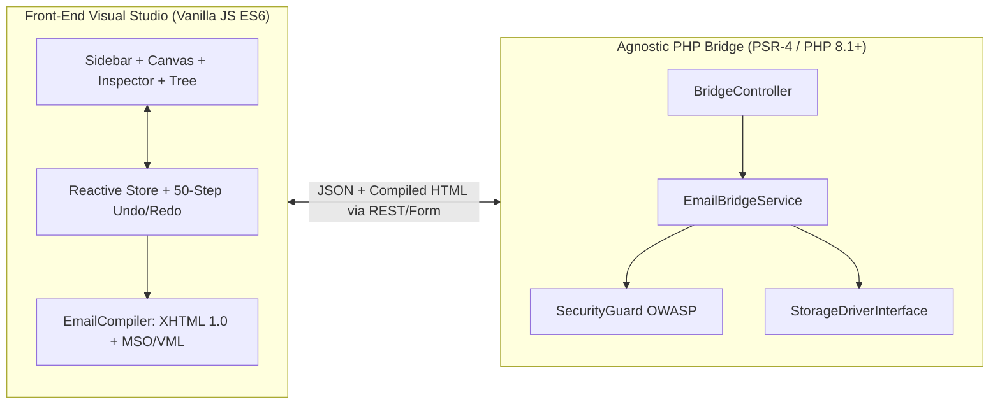

# NewsMailForge — Complete Technical Documentation

**Version**: 1.1.0  
**License**: MIT  
**Author**: Uziel Almeida Oliveira ([uzielweb](https://github.com/uzielweb))

---

## Table of Contents

1. [Architecture Overview](#1-architecture-overview)
2. [Unified Visual Hierarchy (`Row ➔ Column ➔ Element`)](#2-unified-visual-hierarchy-row--column--element)
3. [Visual Studio User Guide](#3-visual-studio-user-guide)
   - [3.1 Drag & Drop Rules](#31-drag--drop-rules)
   - [3.2 Custom Column Proportions & Canvas Resizers](#32-custom-column-proportions--canvas-resizers)
   - [3.3 Inline Rich Text & Image Framing/Link Manager](#33-inline-rich-text--image-framinglink-manager)
   - [3.4 Social Networks Element (Custom Icon Color & Image Replacement)](#34-social-networks-element-custom-icon-color--image-replacement)
   - [3.5 Universal Color Picker (`ColorPickerPopover`)](#35-universal-color-picker-colorpickerpopover)
4. [JavaScript SDK API Reference](#4-javascript-sdk-api-reference)
5. [JSON AST Schema Specification](#5-json-ast-schema-specification)
6. [Email Compiler Specification (Outlook MSO & VML)](#6-email-compiler-specification-outlook-mso--vml)
7. [PHP Bridge & Storage Drivers](#7-php-bridge--storage-drivers)
8. [Internationalization (i18n)](#8-internationalization-i18n)
9. [Security & Quality Assurance](#9-security--quality-assurance)

---

## 1. Architecture Overview

**NewsMailForge** is split into two decoupled layers that can operate together or independently:



- **Zero Front-End Build Dependencies**: All client-side modules under `dist-vanilla/js/` use native ECMAScript Modules (`import` / `export`). No bundler is required.
- **Strict MVC & PSR-4 Backend**: Every action in `src/Controller/BridgeController.php` is capped at `<= 15` lines of code, delegating domain validation and OWASP sanitization to `EmailBridgeService` and `SecurityGuard`.

---

## 2. Unified Visual Hierarchy (`Row ➔ Column ➔ Element`)

To eliminate cognitive friction for email designers, NewsMailForge enforces a clean, flattened visual hierarchy across the Canvas, Sidebar Library, Tree Navigator, and Property Inspector:

| Visual Level | AST Node Type | Role & Capabilities |
| :--- | :--- | :--- |
| **1. Document (`Documento`)** | `generalSettings` | Global email canvas width (`600px` default), outer backdrop color, content area background color, default typography, and preheader text. |
| **2. Row (`Linha`)** | `block` (with 1 `row`) | Horizontal structural section spanning the email width. Supports background color/image, vertical/horizontal padding, borders, mobile stacking (`collapseOnMobile`), and 1 to 6 columns. |
| **3. Column (`Coluna`)** | `cell` | Proportional vertical slot inside a Row (`width` in `%`, e.g., `50%`). Supports per-column background, vertical alignment (`top`, `middle`, `bottom`), padding, and interactive drag-resizing on the canvas. |
| **4. Element (`Elemento`)** | `atom` | Content leaf node placed inside a Column: `text`, `image`, `button`, `divider`, `spacer`, `menu`, or `social`. |

---

## 3. Visual Studio User Guide

### 3.1 Drag & Drop Rules

- **Dragging Structures (`Rows & Columns`) or Ready Row Models**:
  - Always targets the **top (`before`) or bottom (`after`) of an existing Row** on the canvas, displaying `"Drop above this row"` / `"Soltar acima desta linha"` or `"Drop below this row"` / `"Soltar abaixo desta linha"`.
- **Dragging Elements (`Text`, `Image`, `Button`, `Divider`, `Spacer`, `Menu`, `Social`)**:
  - Always targets **inside a Column (`cell`)** (`"Drop inside column"` / `"Soltar dentro da coluna"`) or **before/after an existing Element** inside that column—never above or below a Row.
- **Empty Columns (`+ Insert Content`)**:
  - Newly inserted Rows and Structures initialize with clean empty columns that render an interactive `+ Insert Content` (`+ Inserir Conteúdo`) placeholder.
  - Clicking an empty column (or clicking the borderless `+` edge buttons on a selected element) opens a floating Quick-Insert Popover with all 7 element types.

### 3.2 Custom Column Proportions & Canvas Resizers

- **Sidebar Custom Column Builder (`Row with Custom Columns`)**:
  - Choose between `1` and `6` columns, drag the interactive visual dividers or type exact percentages, and click **`+ Insert Row`** (or drag the preview bar directly onto the canvas).
- **Live Canvas Column Resizers**:
  - Selecting any multi-column Row or Column displays interactive vertical drag handles between columns right on the stage, updating adjacent column percentages in real time.

### 3.3 Inline Rich Text & Image Framing/Link Manager

- **Single-Click Activation**:
  - Clicking a Text element on the stage activates `InlineRichText` immediately (with memoized DOM rendering in `CanvasStage` so typing never loses focus).
- **Inline Image Insertion, Framing & Link Wrapping**:
  - Click the **Image icon** in the floating Rich Text toolbar (or use the **"Inline Image (Framing & Link)"** panel in the right-hand Inspector when a Text element is selected).
  - Configure:
    - **Image URL (`src`)** and **Alternative Text (`alt`)**
    - **Clickable Link URL (`<a href="..." target="_blank">`)** wrapping the inline image
    - **Width (`px`)**
    - **Text Framing / Alignment**:
      - `Float Left (Wrap text)` (`float: left; margin: 4px 12px 8px 0`)
      - `Float Right (Wrap text)` (`float: right; margin: 4px 0 8px 12px`)
      - `Centered (Block)` (`display: block; margin: 8px auto`)
      - `Aligned Left (Block)` (`display: block; margin: 8px auto 8px 0`)
      - `Aligned Right (Block)` (`display: block; margin: 8px 0 8px auto`)
      - `Inline (Text line)` (`display: inline-block; vertical-align: middle`)
  - Clicking any existing `` inside a Text element re-opens the popover pre-filled with that image's current properties.

### 3.4 Social Networks Element (Custom Icon Color & Image Replacement)

When a **Social** element (`atomType === 'social'`) is selected:
1. **Global Icon Theme & Color**:
   - Choose between `Dark` (`#475569`), `Light` (`#ffffff`), `Color (Brand Colors)` (official hex colors for Facebook, Instagram, LinkedIn, Twitter/X, YouTube, GitHub, WhatsApp, Website), or `Custom Color` (`s.iconColor`).
   - Use the **Icon Color** picker in the General section to tint all vector icons simultaneously.
2. **Per-Network Custom Color**:
   - Each network card in the **Social Networks** list features its own color swatch button (`net.color`), allowing individual icon color overrides.
3. **Custom Icon Image URL (`net.customIconUrl`)**:
   - Each network card includes an optional **Custom icon image URL** input. When filled, `EmailCompiler` replaces the inline SVG with an email-safe `` inside the `<a href="...">` link.

### 3.5 Universal Color Picker (`ColorPickerPopover`)

All color controls in the Inspector and Rich Text toolbar use `ColorPickerPopover.js`:
- Interactive 2D Saturation/Value gradient canvas + Hue slider
- 50 curated Email-Safe color swatches + persistent Recent Colors row
- Instant `HEX`, `RGB`, and `HSL` format conversion and input
- One-click `Transparent` button for backgrounds and borders

---

## 4. JavaScript SDK API Reference

Import `NewsMailForge` from `dist-vanilla/js/NewsMailForge.js`:

| Method | Signature | Description |
| :--- | :--- | :--- |
| `NewsMailForge.mount` | `mount(selectorOrElement, options)` | Mounts the full Visual Studio and returns the instance. |
| `instance.getHtml` | `getHtml(): string` | Compiles and returns the production-ready XHTML 1.0 Transitional email string. |
| `instance.getSchema` | `getSchema(): Object` | Returns a deep clone of the current JSON AST document. |
| `instance.setSchema` | `setSchema(schemaObj): void` | Loads a JSON AST document into the Studio and re-renders. |
| `instance.loadPreset` | `loadPreset(presetId): boolean` | Loads one of the 4 built-in templates (`welcome`, `newsletter`, `promotion`, `transactional`). |
| `instance.setLocale` | `setLocale(locale): void` | Switches UI language dynamically (`'pt-BR'` or `'en-GB'`). |

---

## 5. JSON AST Schema Specification

```json
{
  "version": "1.0",
  "title": "Campaign Title",
  "generalSettings": {
    "width": 600,
    "previewText": "Optional preheader summary...",
    "background": { "color": "#f1f5f9" },
    "bodyBackground": { "color": "#ffffff" },
    "spacing": { "padding": [24, 12, 24, 12] }
  },
  "blocks": [
    {
      "id": "blk_01",
      "type": "block",
      "label": "Row",
      "settings": {
        "background": { "color": "#ffffff" },
        "spacing": { "padding": [24, 24, 24, 24] }
      },
      "rows": [
        {
          "id": "row_01",
          "type": "row",
          "settings": { "gap": 16, "collapseOnMobile": true },
          "cells": [
            {
              "id": "cel_01",
              "type": "cell",
              "settings": { "width": "50%", "verticalAlign": "top" },
              "children": [
                {
                  "id": "atm_01",
                  "type": "atom",
                  "atomType": "social",
                  "settings": {
                    "iconTheme": "custom",
                    "iconColor": "#2563eb",
                    "iconSize": 28,
                    "iconGap": 16,
                    "align": "center"
                  },
                  "networks": [
                    {
                      "name": "instagram",
                      "icon": "instagram",
                      "url": "https://instagram.com",
                      "color": "#E4405F",
                      "customIconUrl": ""
                    }
                  ]
                }
              ]
            }
          ]
        }
      ]
    }
  ]
}
```

---

## 6. Email Compiler Specification (Outlook MSO & VML)

`EmailCompiler.compile(doc, options)` enforces strict email client compatibility:
1. **XHTML 1.0 Transitional Doctype & Namespaces**: Includes `xmlns:v="urn:schemas-microsoft-com:vml"` and `xmlns:o="urn:schemas-microsoft-com:office:office"`.
2. **Subpixel Bleeding Fix**: Subtracts `0.2px` inside MSO Ghost Table column widths when multi-column rows are compiled so Outlook 2016/2019/365 Word Engine never wraps the last column prematurely.
3. **Physical Gap Spacer Columns**: Renders explicit `<td class="e-col-gap" width="{gap}">` spacer cells between columns instead of relying on CSS `gap` or `margin`.
4. **Bulletproof VML Buttons**: Wraps `<a class="e-btn">` inside `<!--[if mso]><v:roundrect ...><![endif]-->` so rounded corners and background colors work in desktop Outlook.

---

## 7. PHP Bridge & Storage Drivers

All PHP classes reside under the `NewsMailForge\` PSR-4 namespace (`src/`) and are autoloaded via `bootstrap.php`.

### StorageDriverInterface Contract

```php
namespace NewsMailForge\Contracts;

use NewsMailForge\DTO\EmailDocumentDTO;

interface StorageDriverInterface
{
    public function save(EmailDocumentDTO $document): array;
    public function load(string $id): ?EmailDocumentDTO;
    public function list(int $limit = 50): array;
    public function delete(string $id): bool;
}
```

### REST Endpoints (`examples/api-bridge.php`)

- `POST ?action=save` — Validates schema depth (`<= 12`), sanitizes HTML/URLs via `SecurityGuard`, and persists the `EmailDocumentDTO`.
- `GET ?action=load&id={id}` — Loads a saved document by ID.
- `GET ?action=list&limit=50` — Lists saved documents (`1 <= limit <= 500`).
- `POST ?action=delete&id={id}` — Deletes a saved document by ID.

---

## 8. Internationalization (i18n)

- **Files**:
  - `language/en-GB/en-GB.json` (334 keys)
  - `language/pt-BR/pt-BR.json` (334 keys)
  - `dist-vanilla/js/i18n/I18n.js` (Client-side dictionary with 100% key parity)
  - `src/Core/Lang.php` (Server-side translation loader)
- Automated parity tests in `tests/run_tests.php` verify that every single key exists across both locales and `I18n.js`.

---

## 9. Security & Quality Assurance

Run the automated test suite prior to any release:

```bash
php tests/run_tests.php
```

The runner validates:
1. **UTF-8 No BOM**: Scans all repository files to ensure zero `0xEF 0xBB 0xBF` signatures.
2. **Syntax & ESM Loading**: Executes `php -l` on all PHP files, `node --check` on all JS files, and imports the full `NewsMailForge.js` module tree.
3. **Bidirectional i18n Parity**: Confirms 0 missing keys between `pt-BR`, `en-GB`, and `I18n.js`.
4. **Unit & MVC Compliance**: Tests all 3 storage drivers (`JsonFileStorageDriver`, `ConfigurablePdoDriver`, `CallbackStorageDriver`) and verifies `BridgeController` methods stay `<= 15` lines.
5. **3 Edge Invariant Metatests**: Boundary depth checks (`12` vs `13`), null/exception resilience, and OWASP XSS/SQLi/Path-Traversal blocks.
